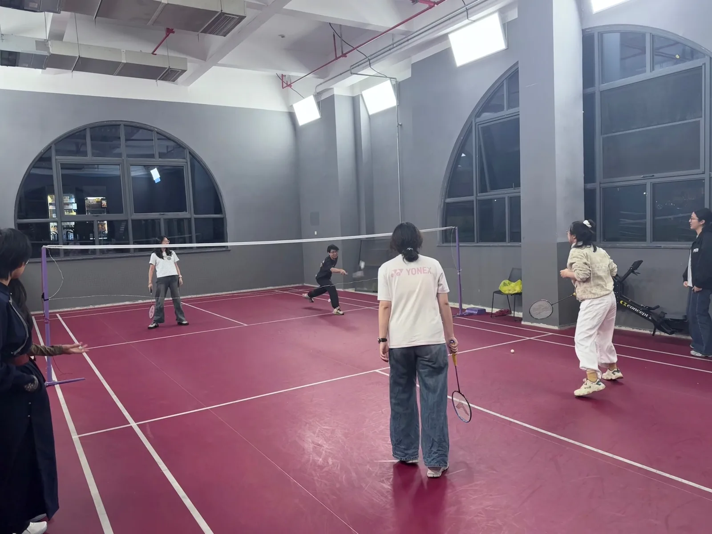
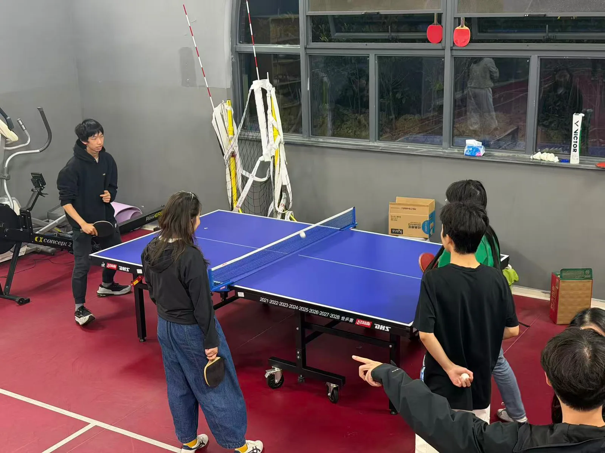
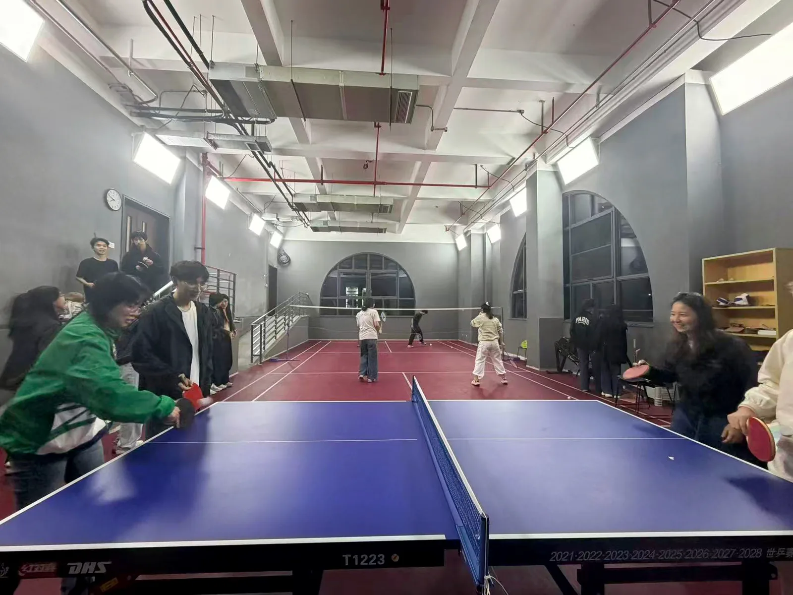
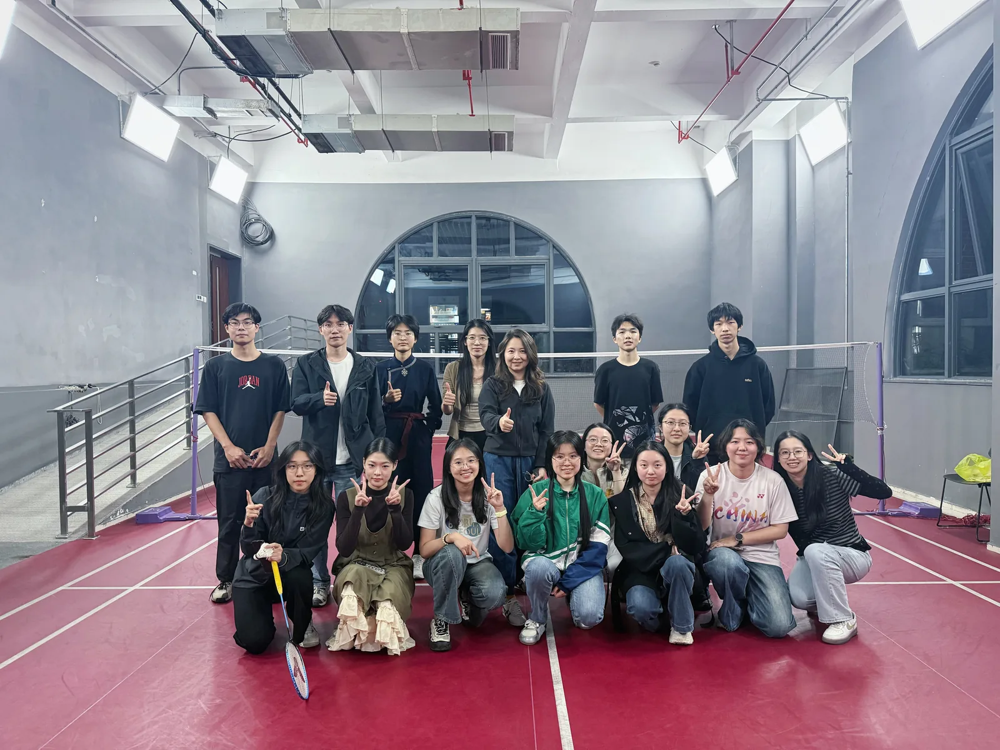
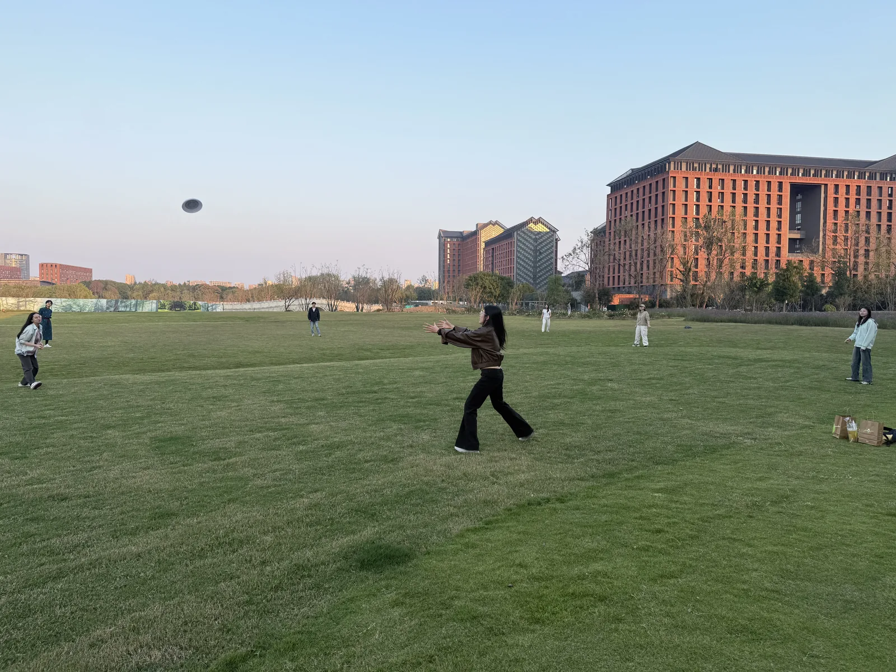
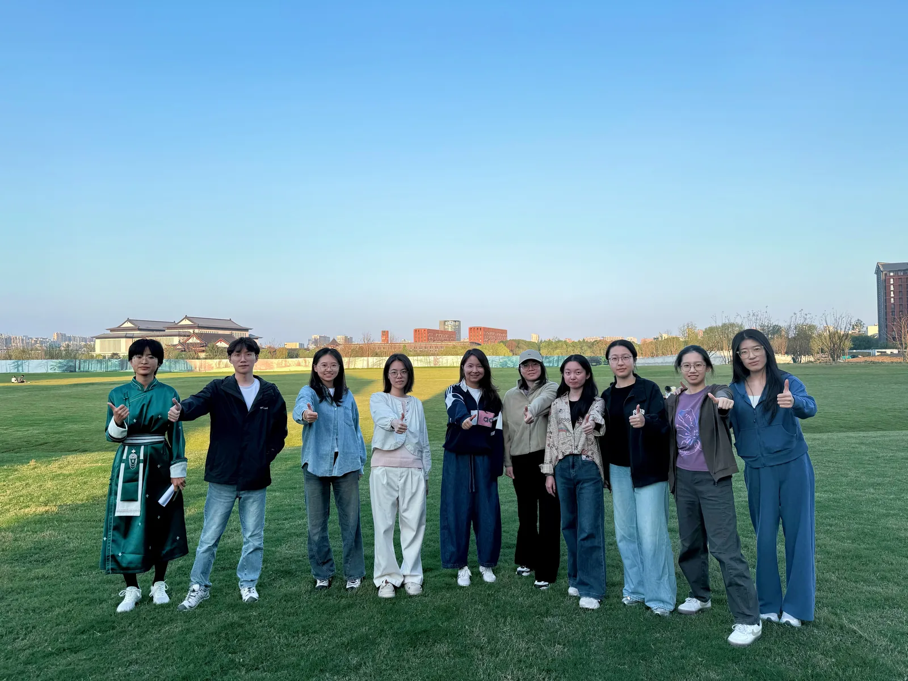
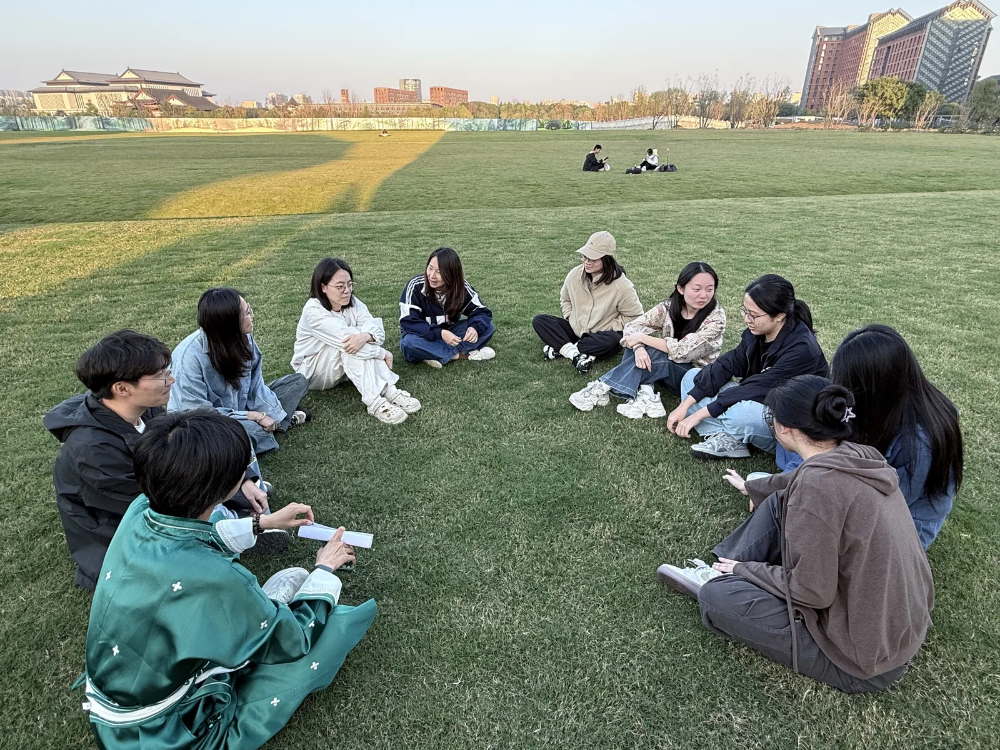
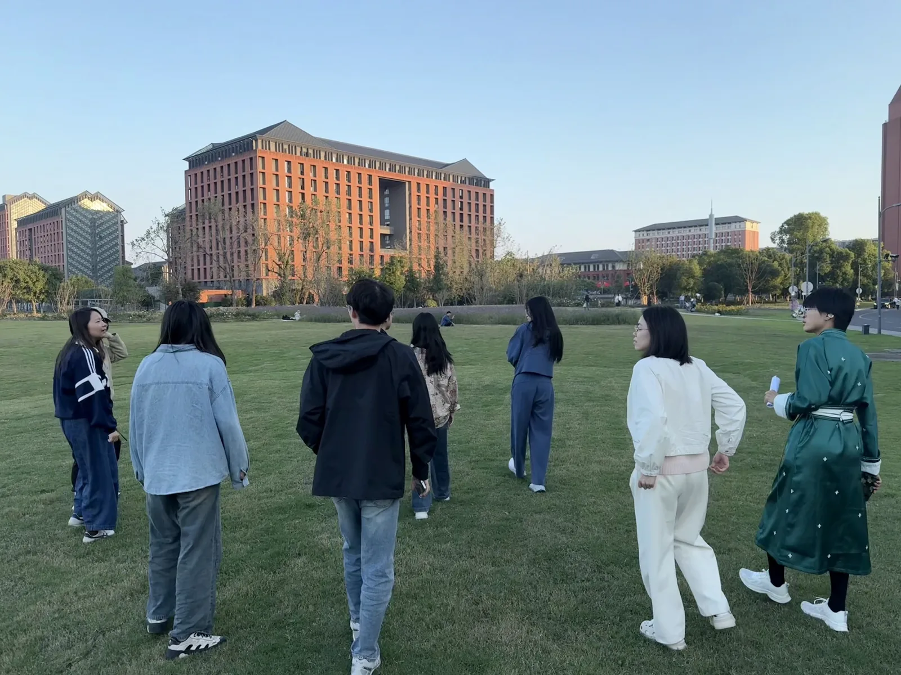

当实验室的伙伴们走出工位，会碰撞出怎样的快乐？

平日里，我们的日常是读文献、做实验、分析数据、讨论论文。但谁说实验室的故事只能发生在电脑和实验台前？

这个秋天，浙江大学心理与行为科学系情绪与文化实验室的师生们暂时放下手中的科研任务，把相聚的地点从会议室搬到了球场和草坪。

从羽毛球、乒乓球到飞盘、健步走，再到新鲜有趣的匹克球，四场活动，四种打开方式。没有论文截止日期的紧迫，也不必纠结实验结果是否显著。大家在运动中放松身心，在交流中拉近距离。

这一次，我们不仅是科研路上的同行者，也是运动场上的好搭档！

## 第一站｜羽球飞扬，乒出默契

**9月29日   心理系系楼体育活动场地**

系列活动的第一站，从大家熟悉的羽毛球和乒乓球开始！

20位实验室成员齐聚活动场地，分成羽毛球和乒乓球两个小组。不过，这次比赛有一点特别：没有固定队友，也没有固定对手！

大家随机抽签组队，师生混合、男女搭配。每完成一局，双方各交换一名队员，重新组队、继续开打。上一局还是对手，下一局可能就成了并肩作战的搭档。

比赛不记录总分与胜负，还设置了“最佳默契搭档奖”和“最高参与奖”。比起谁的球技更胜一筹，大家更在意的是有没有玩得尽兴、配合得默契。

运动之余，师生也分享着各自的运动体验与科研减压感受。原本围绕实验和论文展开的交流，在球场上多了几分轻松与自在。

**第一站关键词：打破固定搭档，认识更多伙伴！**

<figure class="news-figure" markdown="1">

{.news-img-center width="1600" height="1200" loading="lazy" decoding="async" data-caption="羽毛球活动现场"}

<figcaption>【羽毛球活动现场】</figcaption>
</figure>

<figure class="news-figure" markdown="1">

{.news-img-center width="1600" height="1200" loading="lazy" decoding="async" data-caption="乒乓球轮换比赛"}

<figcaption>【乒乓球轮换比赛】</figcaption>
</figure>

<figure class="news-figure" markdown="1">

{.news-img-center width="1600" height="1200" loading="lazy" decoding="async" data-caption="两场比赛如火如荼进行中"}

<figcaption>【两场比赛如火如荼进行中】</figcaption>
</figure>

<figure class="news-figure" markdown="1">

{.news-img-center width="1600" height="1200" loading="lazy" decoding="async" data-caption="师生合影"}

<figcaption>【师生合影】</figcaption>
</figure>

## 第二站｜快乐飞盘，接住好心情

**10月20日 · 心理系系楼对面大草坪**

告别球拍，第二站来到熟悉的校园大草坪！

这一次，师生相聚户外，体验轻松有趣的飞盘活动。

大家先分组练习，熟悉飞盘的投掷与接取方式，随后围成一个圈，自由传接飞盘。没有复杂的规则，也没有激烈的积分争夺，大家跟着飞盘移动、调整位置，在一来一回的传接中逐渐找到配合的节奏。

相比第一站的球类竞技，这次活动更加自由随性。大家既能舒展身体，也能在活动间隙聊聊近期的情绪状态与生活趣事，让积累的科研压力随着运动得到释放。

**第二站关键词：传递飞盘，也传递好心情！**

<figure class="news-figure" markdown="1">

{.news-img-center width="1600" height="1200" loading="lazy" decoding="async" data-caption="草坪围圈传接飞盘"}

<figcaption>【草坪围圈传接飞盘】</figcaption>
</figure>

## 第三站｜并肩健步，边走边聊

**10月26日 · 紫金港校区西区**

如果说前两站主要靠运动增进默契，那么第三站，我们决定一边走路，一边好好聊聊天！

师生从心理系系楼对面的大草坪出发，沿着紫金港校区西区的道路前行，途经理科组团、银泉生活组团和玉湖生活组团，完成约2公里的健步走。

这次健步走还有一项特别安排：随机两两结伴，边走边聊。

最近的实验进展怎么样？科研中遇到了什么困难？生活中有没有开心的小事？面对压力，又有哪些适合自己的调节方式？

从科研进展到生活日常，从情绪体验到压力调节，大家在行走中自然地打开话匣子。不需要提前准备PPT，也没有正式汇报的紧张感，师生在轻松的交谈中分享近况、交流想法。

两公里的路程不算长，却让大家有机会放慢脚步，更加了解彼此。

**第三站关键词：脚步不停，话题不断！**

<figure class="news-figure" markdown="1">

{.news-img-center width="1600" height="1200" loading="lazy" decoding="async" data-caption="健步走出发现场"}

<figcaption>【健步走出发现场】</figcaption>
</figure>

<figure class="news-figure" markdown="1">

{.news-img-center width="1600" height="1200" loading="lazy" decoding="async" data-caption="结伴交流分组"}

<figcaption>【结伴交流分组】</figcaption>
</figure>

<figure class="news-figure" markdown="1">

{.news-img-center width="1600" height="1200" loading="lazy" decoding="async" data-caption="沿途集体合影"}

<figcaption>【沿途集体合影】</figcaption>
</figure>

## 第四站预告｜匹克球初体验，换个搭档再来一局！

**拟于11月9日开展 · 拍乐匹克球馆**

前三站玩得尽兴，第四站当然也要安排点新花样！

11月9日，情绪与文化实验室计划组织20位成员前往拍乐匹克球馆，开启一场轻松有趣的匹克球友谊赛。

活动将延续第一站的特色：搭档不固定，互动不停歇！

师生将先随机两两组队，共同学习匹克球的基本技巧，再通过轮换搭档、更换对手的方式展开友谊赛。无论是初次尝试还是已有经验，都能在共同练习、相互配合中找到运动的乐趣。

运动间隙，大家还可以聊聊科研生活中的压力与调节心得，让球场成为放松身心、增进交流的新空间。

期待这场新鲜有趣的匹克球体验，为系列活动画上一个充满活力的句号！

**第四站关键词：新运动、新搭档，默契再升级！**

## 从三场活动出发，期待更多精彩！

从羽毛球与乒乓球轮换赛中的破冰熟悉，到飞盘传接中的轻松协作，再到健步走途中的深入交流，已经开展的三场活动，为师生留下了不少共同回忆。

截至目前，三场活动累计45人次参与，导师全程加入，与同学们一起运动、组队、交流。在实验室里，我们是共同探索问题的科研伙伴；在运动场上，我们也是相互鼓励、分享心情的队友。

对于情绪与文化实验室来说，运动不仅是锻炼身体的方式，也为大家提供了感受情绪、交流压力、获得支持的机会。一次结伴行走、一场不计胜负的友谊赛，都让“导学同行”有了更加具体的模样。

而即将到来的匹克球友谊赛，也将为这段导学时光增添新的体验。我们期待在新的运动项目中延续此前的轻松氛围，让师生在更多合作与交流中进一步加深了解。

## 下一站，继续同行！

三场活动已经留下了许多快乐的瞬间，第四场匹克球友谊赛也即将到来。

回到实验室，我们依然要面对文献、实验、数据和论文。不过现在，我们又多了一些共同的回忆：一起打过的球、传接过的飞盘、走过的校园小路，还有运动间隙那些轻松自在的聊天。

科研需要专注与坚持，也需要适时放松、彼此支持。11月9日，匹克球场见！期待大家继续走出实验室，在运动中充电，在交流中同行！

——情绪与文化实验室导学团队
